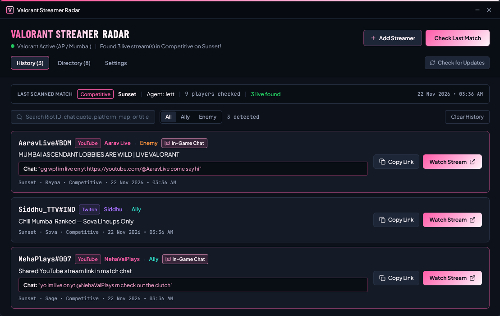

<div align="center">

# Valorant Streamer Radar

**Discover whether players from your last finished Valorant match were streaming live on YouTube, Twitch, or Kick — strictly post-match, server-aware, and confidence-tiered.**

<sub><b>Zero in-game FPS hit</b> &middot; ~10–25 MB RAM in tray &middot; ~0% CPU &middot; 0 MB GPU VRAM (native Rust, no Electron)</sub>

<p align="center">
  <a href="https://github.com/svg2709/Valorant-Streamer-Radar/releases/latest">
    
  </a>
  &nbsp;
  <a href="https://github.com/svg2709/Valorant-Streamer-Radar/releases/latest/download/ValorantStreamerRadar.exe">
    
  </a>
</p>

<sub>Looking for older builds, SHA-256 checksums, or full release notes? Check <a href="CHANGELOG.md">CHANGELOG.md</a>, <a href="https://github.com/svg2709/Valorant-Streamer-Radar/releases">Releases</a>, or <a href="https://github.com/svg2709/Valorant-Streamer-Radar/actions">Actions</a>.</sub>

<br /><br />


-10b981?style=flat-square)


<br />



</div>

---

## Is This Bannable?

**Short answer: NO — Valorant Streamer Radar is NOT a cheat, NOT a stream-sniping tool, and is specifically built NOT to interfere with Valorant or Vanguard.**

- **Not a stream sniping tool (strictly post-match only):** Never scans live lobbies, agent select, or active matches. The app intentionally waits until your match has completely ended (`InGame -> MainMenu` in `ShooterGame.log`) or until you manually click **Check Last Match** after finishing a game — providing zero live competitive advantage.
- **No mid-match notifications or overlays:** Desktop notifications never fire while a match is in progress, and the app never draws over your game or inspects live rosters.
- **Zero gameplay, memory, or GPU interference:** Runs 100% in user space—never reads/writes game memory, never injects DLLs, never modifies game files, and never hooks DirectX, OpenGL, or Vulkan.
- **Intended purpose:** Help players find VODs, review matches from another perspective, say GG after a game, and discover creators playing on the same Valorant servers.

> **Is it bannable? (Required Disclaimer):** While **Valorant Streamer Radar is NOT designed to break Riot's fair-play rules and does not touch Valorant's game process or Vanguard**, Riot Games does not officially endorse third-party tools that read the local Riot Client API (`lockfile`), and Vanguard or Terms of Service policies can change at any time. In short: it is **not** a cheat or stream-sniping tool and provides **zero** in-game advantage, but as with any unofficial Riot API tool, you use it **at your own risk**.

---

## Detection Limitations

**Streamer detection is NOT 100% accurate.** Results are best-effort signals derived from public platform data, community-verified records, and server compatibility checks.

Please keep the following limitations in mind:

- **False positives & missed detections:** Live-stream matching cannot guarantee that a live channel belongs to a specific player in your lobby, and streamers whose channel names differ completely from their Riot ID (and who are not in the database) may not be detected.
- **Username & alias changes:** Players frequently change Riot IDs, play on alternate accounts, or use Streamer Mode / hidden names, which can reduce matching accuracy unless those aliases are recorded in the streamer database.
- **Server / region verification limits:** Many Twitch, YouTube, and Kick streams do not expose which exact Valorant server the creator is queued on. When a streamer's in-game server cannot be verified, Valorant Streamer Radar marks the match as **Unverified** rather than reporting it as a confirmed detection.
- **API quotas, rate limits, & network availability:** YouTube, Twitch, Kick (Cloudflare), and GitHub APIs impose rate limits or intermittent blocks. Failed checks are reported gracefully rather than treated as confirmed results.
- **Community database coverage:** Exact high-confidence matches rely heavily on verified entries in `streamers.json` and your local custom list. Unlisted creators fall back to lower-confidence heuristic matching.
- **Recommendations are NOT match detections:** The optional **Discover** tab shows regional live stream suggestions only—they are strictly separated from players detected in your lobby.

---

## Key Features (v1.2.11)

### 1. Embedded Pure-Rust ML & Server-Aware Streamer Detection
- **Keyless offline ML scoring engine:** Uses Jaro-Winkler, character n-gram Dice, gaming phonetic encoding, leet-speak unfolding, affix stripping, match-context alignment (agent, map, queue, Riot tag), and a calibrated logistic regression classifier directly in Rust — with zero API keys, zero cloud latency, and 0 MB GPU VRAM.
- **Broadcast & non-gameplay filtering:** Automatically suppresses false positives from VCT watch parties, co-streams, 24/7 reruns, rebroadcasts, and clip/highlight channels.
- **Three clear confidence tiers:** Every match is classified as **Confirmed**, **Probable**, or **Unverified**—never treating weak display-name similarity as a confirmed streamer.
- **Server-first matching:** Compares your actual in-game Valorant server against the streamer's verified or detected in-game server (prioritizing actual in-game server over streaming region or language).
- **Cross-server false-positive rejection:** Incompatible regions (for example, an NA/US streamer appearing while you play on the **Mumbai** server) are penalized or rejected instead of being falsely flagged.
- **Unknown server protection:** If a streamer's active Valorant server cannot be verified, the match is capped at **Unverified** and does not trigger a desktop toast notification.
- **Multi-alias streamer database:** Supports primary Riot IDs plus multiple alternate Riot IDs (`aliases`) per creator without duplicating entries.

### 2. Party Member Detection & API Optimization
- **Zero extra Riot API calls:** Reads each player's `partyId` directly from Riot's post-match `match-details` response.
- **Automatic party skipping (ON by default):** Excludes your own party teammates from external YouTube/Twitch/Kick lookups, reducing network requests, scan latency, and API quota usage.
- **Dynamic per-match adaptation:** Automatically adapts when party members join or leave between games, and can be toggled ON/OFF anytime in **Settings**.

### 3. Organized Match History & Multi-Criteria Filtering
- **Latest Match vs. Previous History:** Your most recent scanned match is displayed in a dedicated **Latest Match** subsection (including queue type, map, server, agent, players scanned, party members skipped, and detections), separated by a divider from **Previous History**.
- **Combinable, non-destructive filters:** Filter history simultaneously by **Search**, **Team** (`All` / `Ally` / `Enemy`), **Match Type**, **Server**, **Date/Time** (`All Time`, `Today`, `Last 7 Days`, `Last 30 Days`), and **Detection Status** (`Confirmed`, `Probable`, `Unverified`, `In-Game Chat`), with one-click **Reset Filters**.

### 4. Community Streamer Database & Moderated Submissions
- **Central structured database (`streamers.json`):** Stores verified streamer entries (`id`, `display_name`, `riot_id`, `aliases`, `platform`, `channel_id`, `channel_name`, `channel_url`, `server_region`, `verified`, `submitted_at`, `source`).
- **Simple in-app submission workflow:** Regular users can submit new streamers or aliases via **+ Add Streamer** without configuring or managing Git repositories.
- **Moderated verification:** Submissions are validated for schema & allowed domains (`youtube.com`, `youtu.be`, `twitch.tv`, `kick.com`), checked for duplicates, and reviewed by maintainers before being approved and merged via GitHub Actions.

### 5. Optional Regional Recommendations (OFF by Default)
- **Disabled by default to save bandwidth:** Zero recommendation network requests are sent while the feature is OFF, and the **Discover** tab stays hidden from the sidebar until you turn recommendations ON in **Settings**.
- **Cached discovery:** When enabled in **Settings**, unlocks the **Discover** tab to fetch regional live Valorant streams on Twitch/YouTube with a **5-minute local cache** and clearly labels them as **Discovery Suggestions — Not Matched to Your Lobby**.

### 6. Automatic Version Update Detection & Synced Changelog
- Compares the installed version (`v1.2.11`) against the latest published GitHub Release (toggleable in Settings, ON by default, and shown only inside the GUI when opened).
- Displays the latest version number, release changelog (synced directly from [`CHANGELOG.md`](CHANGELOG.md)), and download/install action when a newer version is available.
- **Automatically hides** the update notification when no newer version is pending—no manual dismissal needed.
- Gracefully handles network errors, missing releases, and GitHub API rate limits without falsely claiming the app is up to date.

---

## Supported Valorant Servers

User-facing terminology throughout the app uses **Servers** instead of internal Riot shards. All major Valorant servers are supported for auto-detection, manual override, history filtering, and region-aware matching:

| Region Group | Supported Servers |
| :--- | :--- |
| **Asia-Pacific (AP)** | **Mumbai**, **Singapore**, **Tokyo**, **Manila**, **Hong Kong**, **Sydney** |
| **Korea (KR)** | **Seoul** |
| **North America (NA)** | **Austin** *(Texas / Dallas)*, **US East** *(Virginia / Georgia / Illinois)*, **US West** *(California / Oregon)* |
| **Latin America & Brazil** | **LATAM** *(Mexico / Bogota / Santiago)*, **Sao Paulo** *(Brazil)* |
| **Europe, Middle East & Africa (EU)** | **London**, **Frankfurt**, **Paris**, **Stockholm**, **Warsaw**, **Madrid**, **Istanbul**, **Bahrain**, **Cape Town** |

---

## How It Works

1. **Runs quietly in the Windows system tray** while Valorant is open and auto-detects your active Valorant server from `ShooterGame.log` without touching game memory or GPU hooks.
2. **Waits until your match completely finishes** (`InGame -> MainMenu`) — because this is **not a stream-sniping tool**, it never scans live lobbies or sends mid-match alerts. Optional match text chat is only buffered in memory and parsed strictly after the game ends.
3. **Reads your completed match** via Riot's local lockfile (`match-details`) and identifies party members via `partyId` so they can be skipped.
4. **Evaluates remaining players** against the local & community streamer database (including aliases), server-aware live checks on YouTube/Twitch/Kick, and post-match chat links.
5. **Categorizes detections by confidence tier** (**Confirmed**, **Probable**, **Unverified**), displays results in **Latest Match**, and sends a Windows toast notification only for **Confirmed** or **Probable** matches.

---

## Download & Installation

### Option 1: Direct Download (Windows 10/11)
1. Download `ValorantStreamerRadar.exe` from the **[Latest Release](https://github.com/svg2709/Valorant-Streamer-Radar/releases/latest)**.
2. Run `ValorantStreamerRadar.exe` while Valorant is installed.
   *(If Windows SmartScreen prompts for an unsigned open-source binary, choose **More info -> Run anyway**.)*

### Option 2: Build & Test Locally on Windows (Rust 1.80+)
```powershell
git clone https://github.com/svg2709/Valorant-Streamer-Radar.git
cd Valorant-Streamer-Radar
cargo test
cargo build --release
```
The compiled binary is placed at `target\release\ValorantStreamerRadar.exe`.

### Interactive Browser Preview (Vite + React)
```bash
npm install
npm run dev
```

---

## Settings Overview

All settings use accessible left-to-right **ON/OFF** toggle sliders and are saved atomically to `%APPDATA%\ValorantStreamerRadar\config.json` (see [`examples/config.example.json`](examples/config.example.json)). Legacy config files using `shard_override` are migrated automatically.

| Setting | Default | Description |
| :--- | :---: | :--- |
| **Active Valorant Server** (`server_override`) | `auto` | Auto-detects your Valorant server from `ShooterGame.log`, or lets you pin any supported server (Mumbai, Tokyo, Manila, Austin, etc.). |
| **Skip Party Members** (`skip_party_members`) | **ON** | Excludes party teammates (`partyId`) from external YouTube/Twitch/Kick scans to save API calls and speed up scans. |
| **Live Streamer Recommendations** (`enable_recommendations`) | **OFF** | Optional Discover tab suggestions. Enabling may increase internet usage; sends zero network requests while OFF. |
| **Post-Match In-Game Chat Stream Plugs** (`capture_in_game_chat`) | **ON** | Buffers match chat and extracts self-posted stream links strictly after the match ends. |
| **Start Silently with Windows** (`start_with_windows`) | **ON** | Registers auto-start minimized in the tray via `HKCU\Software\Microsoft\Windows\CurrentVersion\Run`. |
| **Check for Updates on Boot** (`check_updates_on_boot`) | **ON** | Silently checks GitHub Releases on startup and displays the update banner only when you open the GUI. |
| **YouTube / Twitch API Keys** | *(blank)* | Optional. The app runs keyless out of the box, or accepts free YouTube Data API v3 / Twitch Helix credentials for faster official lookups. |

---

## Performance & RAM Usage

Built as a single lightweight **native Rust** binary with **no Electron or Chromium runtime** — designed to sit quietly in your system tray with zero FPS impact while you play.

| State | Typical RAM Usage | CPU Usage | GPU VRAM |
| :--- | :---: | :---: | :---: |
| **System Tray Idle (During Matches)** | **~10 – 25 MB** | **~0%** | **0 MB** |
| **App Window Open (Browsing / Settings)** | **~30 – 65 MB** | **< 1%** | **0 MB** |
| *Typical Electron / Browser-Based Tracker* | *~250 – 600+ MB* | *2 – 8%* | *100+ MB* |

- **Zero GPU VRAM & zero FPS impact:** Uses pure CPU software rendering (`egui` + `egui_software_backend` + `softbuffer` Win32 GDI) with no DirectX, OpenGL, or Vulkan swapchain—so it never consumes GPU memory or impacts Valorant frame rates.
- **Tray idle behavior:** When closed to the Windows system tray, the GUI hides (`WINDOW_VISIBLE = false`) and completely stops repainting; only the lightweight background log watcher remains active.
- **Note:** Exact working-set RAM varies slightly depending on your Windows build and saved match history size, and can be verified anytime in Windows Task Manager.

---

## Project Structure

```text
Valorant-Streamer-Radar/
├── .github/
│   ├── ISSUE_TEMPLATE/add-streamer.yml       # Structured community streamer submission form
│   └── workflows/
│       ├── build-windows.yml                 # Runs cargo test, builds Windows .exe, syncs CHANGELOG.md to Releases
│       └── merge-approved-streamer.yml       # Validates & merges approved submissions into streamers.json
├── examples/
│   ├── config.example.json                   # Sample %APPDATA% config.json
│   └── streamers.example.json                # Sample streamer database schema
├── src/
│   └── main.rs                               # Native Windows Rust application + unit tests
├── web/                                      # Interactive React/TypeScript web simulator
├── streamers.json                            # Central moderated community streamer database
├── CHANGELOG.md                              # Versioned release notes (source for GitHub Releases)
├── Cargo.toml                                # Rust package manifest (v1.2.11)
└── README.md
```

---

## Troubleshooting

- **"Riot Client not running" when clicking Check Last Match:** Make sure Valorant or the Riot Client is open so the local lockfile exists at `%LOCALAPPDATA%\Riot Games\Riot Client\Config\lockfile`.
- **Wrong server auto-detected:** Open **Settings -> Valorant Servers & Detection** and select your server manually (e.g., **Mumbai**, **Tokyo**, **Manila**, **Austin**).
- **Update check fails with rate-limit or network error:** GitHub limits unauthenticated API requests per IP. Open the [Releases page](https://github.com/svg2709/Valorant-Streamer-Radar/releases) directly or retry later; failed checks never falsely claim you are up to date.
- **Kick shows not live even when a creator is streaming:** Kick sits behind Cloudflare and may return HTTP `403`, which the app safely treats as unavailable rather than crashing.
- **Toast notifications show "Windows PowerShell":** Custom Windows Toast App ID is enabled automatically by default; if Windows still falls back to PowerShell, check whether local Windows policy restricts `HKCU` registry writes.

---

## Changelog

See [`CHANGELOG.md`](CHANGELOG.md) for the complete version history and release notes for **v1.2.11** and earlier versions.

---

> **Note:** This project is **100% vibecoded** — built entirely through iterative prompting and testing. Issues, bug reports, and pull requests are always welcome!
