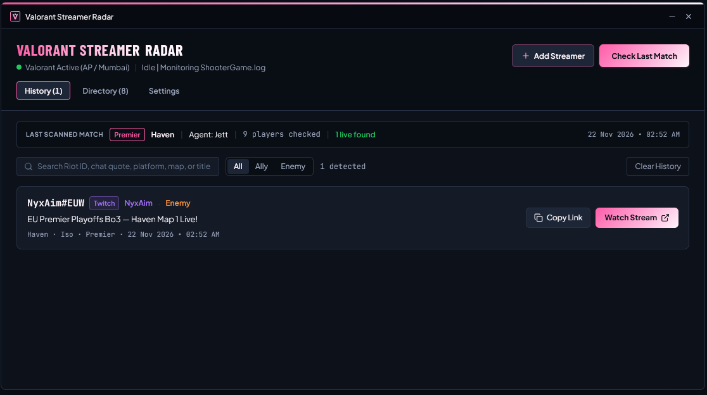

<div align="center">

# Valorant Streamer Radar

***This is 100% vibe coded.***

**Find out if anyone in your last Valorant lobby was streaming live on YouTube, Twitch, or Kick — automatically, silently, and strictly after the match ends.**


<br />



</div>

---

## Is This Bannable?

> **Short answer: No — this app is built to be Vanguard-safe and does not provide any in-game advantage.**
>
> **Disclaimer: Use this software at your own risk. If your Riot account is ever warned, suspended, or banned for any reason while using this tool, I will NOT be responsible.**

### Why it is designed to be safe
- **100% user-space only:** It **never** reads or writes game memory, **never** injects DLLs, **never** hooks DirectX/Vulkan or any Valorant process, and **never** draws in-game overlays.
- **Strictly post-match:** It never inspects live agent-select lobbies or notifies you mid-match (so it cannot be used for stream-sniping). Scans only trigger after `ShooterGame.log` records an `InGame -> MainMenu` transition or when you manually click **Check Last Match**.
- **Standard local read-only data:** It only tails Riot's local `ShooterGame.log`, reads Riot Client's local `lockfile` (the same local endpoint used by popular Valorant companion apps), and checks public stream URLs on YouTube, Twitch, and Kick.
- **Strict URL allowlisting:** Every community directory entry and extracted chat link is strictly validated against `youtube.com`, `youtu.be`, `twitch.tv`, and `kick.com` (no userinfo, no custom ports, no arbitrary links).

> **Important Note:** Riot Games does not officially endorse third-party tools that interact with the local Riot Client API, and their Terms of Service or Vanguard policies can change at any time. By downloading, building, or running Valorant Streamer Radar, you acknowledge that you do so **at your own risk**, and the author/contributors accept **zero liability** for any account action, penalty, or ban.

---

## Features

- **Post-Match Live Stream Detection:** Automatically checks all other players from your last finished match across **YouTube**, **Twitch**, and **Kick**.
- **In-Game Text Chat Stream Plug Capture:** Silently buffers match text chat via Riot's local chat API while you play and, *only after the match ends*, extracts live plugs and stream links (e.g., `"gg im live on yt"`, `"ttv/handle"`, or pasted YouTube/Twitch/Kick URLs) and shows the captured quote right in your History card and Windows toast notification.
- **Last Scanned Match Summary:** Displays the exact queue/match type (**Competitive**, **Deathmatch**, **Swiftplay**, **Unrated**, **Premier**, **Spike Rush**, etc.), **Map**, your **Agent**, players checked, and how many live streamers were found.
- **Streamer Directory + Credential Verification:** Maintain your own `custom_streamers.json` list alongside a synced GitHub community directory, with a built-in **Verify Channel** button to check that a streamer's link and display name are valid before saving.
- **Works Keyless Out of the Box (+ Optional API Keys):** Runs completely without API keys by default, with optional YouTube Data API v3 and Twitch Helix support—plus built-in step-by-step setup guides and quick-launch links right inside Settings.
- **Multi-Region Shard Auto-Detection:** Automatically detects your Riot shard (`ap`, `na`, `eu`, `kr`) from `ShooterGame.log` with a manual override option in Settings.
- **Ultra-Lightweight Native Windows Tray App:** Written in pure Rust (`eframe/egui 0.29`, `tray-icon 0.19`, `tokio`, `tauri-winrt-notification`). Uses ~5 MB idle RAM and ~0% idle CPU while minimized to the system tray, with branded native Windows toast notifications.

---

## How It Works

1. **Runs quietly in the tray** while Valorant is open and detects your active shard automatically.
2. **Waits for the match to finish** (`InGame -> MainMenu` in `ShooterGame.log`), buffering match chat silently in memory if enabled.
3. **Fetches your last completed match** (mode, map, agents, teams, and player Riot IDs) via Riot's local lockfile and post-match history endpoint.
4. **Checks each player** against your local & community Streamer Directory, keyless/API live checks, and any stream links shared in match chat—then pops a **Windows Toast notification** and saves the result to your History tab.

---

## Getting Started

### Option 1: Download Prebuilt Windows `.exe` (GitHub Actions / Releases)
1. Go to the **Actions** tab (or **Releases**) in this repository.
2. Download the latest `val-streamer-notifier.exe` build artifact.
3. Run `val-streamer-notifier.exe` while Valorant is installed on Windows 10/11.
   *(If Windows SmartScreen shows a prompt for an unsigned open-source `.exe`, click **More info -> Run anyway**.)*

### Option 2: Build Locally on Windows (Rust 1.80+)
```powershell
git clone https://github.com/svg2709/ValStreamerRadar.git
cd ValStreamerRadar
cargo build --release
```
Your executable will be generated at:
```text
target\release\val-streamer-notifier.exe
```

---

## Configuration

Settings are managed directly inside the app's **Settings** tab and saved atomically to:
```text
%APPDATA%\ValorantStreamerRadar\config.json
```

The app creates this file automatically on first launch and works completely keyless out of the box:

```json
{
  "youtube_api_key": "",
  "twitch_client_id": "",
  "twitch_client_secret": "",
  "start_with_windows": true,
  "shard_override": "auto",
  "github_owner": "your-github-username",
  "github_repo": "valorant-streamers-db",
  "use_custom_toast_app_id": true,
  "capture_in_game_chat": true
}
```

| Field | Description |
| :--- | :--- |
| `youtube_api_key` | Optional YouTube Data API v3 key. Falls back to keyless YouTube live search if empty or rate-limited. |
| `twitch_client_id` / `twitch_client_secret` | Optional Twitch Helix OAuth2 credentials. Falls back to public Twitch GQL if omitted. |
| `start_with_windows` | Adds/removes `HKCU\Software\Microsoft\Windows\CurrentVersion\Run\ValorantStreamerRadar` (`--background`). |
| `shard_override` | `"auto"` (reads from `ShooterGame.log`, fallback `"ap"`), or force `"ap"`, `"na"`, `"eu"`, `"kr"`. |
| `github_owner` / `github_repo` | GitHub repo hosting `main/streamers.json` for authoritative Riot ID -> channel lookups. |
| `use_custom_toast_app_id` | Registers `ValorantStreamerRadar` in `HKCU` so Windows toasts show the app name & icon instead of PowerShell. |
| `capture_in_game_chat` | Silently captures in-game text chat and extracts live stream plugs/links post-match. |

---

## Community Directory Schema (`streamers.json`)

To share a curated streamer database across friends or a community, host a `streamers.json` file in the `main` branch of your configured GitHub repository:

```json
[
  {
    "riot_id": "Name#TAG",
    "platform": "YouTube",
    "channel_name": "Channel Display Name",
    "channel_url": "https://www.youtube.com/@ChannelHandle"
  }
]
```

- `platform`: `"YouTube"`, `"Twitch"`, or `"Kick"`
- `channel_url`: Must be a plain `https://` URL on an allowed platform host (`youtube.com`, `youtu.be`, `twitch.tv`, or `kick.com`).

---

## Known Limitations

- **Kick / Cloudflare:** Kick sits behind Cloudflare and may periodically return HTTP `403`; those responses are safely treated as "not live".
- **Heuristic False Positives:** Keyless IGN heuristics can occasionally match unrelated channels—add known creators to your local Directory or community `streamers.json` for exact matches.
- **Chat Room Timing:** Riot clears the in-game match chat room shortly after returning to the main menu; keeping the app running in the tray during matches lets it buffer chat reliably before the room closes.
- **Custom Toast AppID Fallback:** If `use_custom_toast_app_id` is disabled or Windows Registry writes are blocked by policy, toasts fall back to the `"Windows PowerShell"` AppUserModelID.
